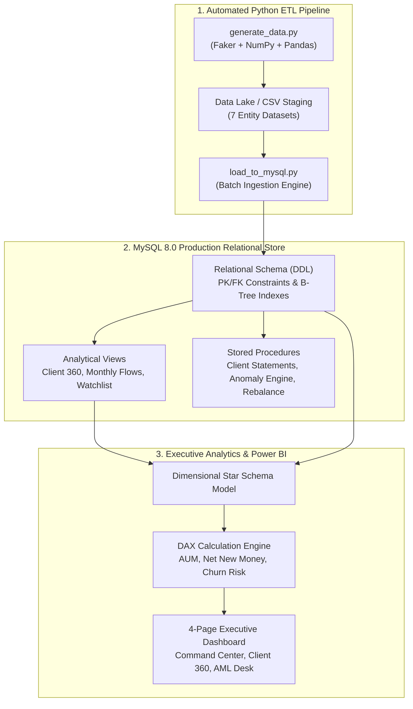
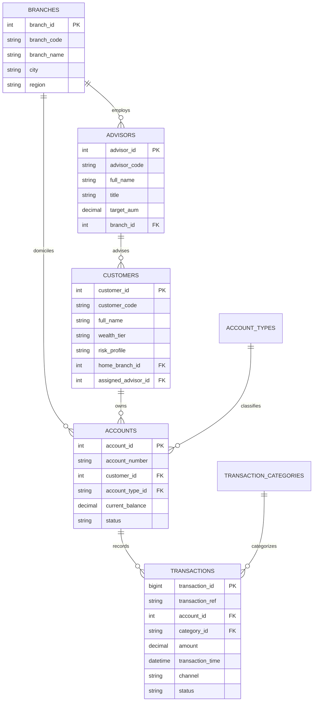

# Morgan Stanley Wealth Management — Banking Transaction & Customer Analytics

[](https://www.mysql.com/)
[](https://powerbi.microsoft.com/)
[](https://www.python.org/)
[](#)

An enterprise-grade analytical system modeling **Wealth Management, Client Portfolio Liquidity, and Banking Transactions**, engineered specifically to demonstrate technical proficiency in **Advanced SQL**, **Database Engineering**, **Python ETL Automation**, and **Power BI Data Modeling**.

---

## 1. Project Overview & Architecture

Designed around the operating model of **Morgan Stanley Wealth Management (Home Office)**, this project captures the end-to-end client journey: from high-net-worth customer segmentation and relationship manager assignments to multi-asset account portfolios and transaction processing.



---

## 2. Relational Database Schema (ERD)

The database schema (`morgan_stanley_wm`) enforces full referential integrity across 7 normalized entities:



---

## 3. Advanced SQL Query Capabilities

The repository includes a suite of production-ready queries answering critical business questions:

### A. Customer Volume Ranking (`DENSE_RANK()`, `SUM() OVER()`)
*Identifies top relationships driving institutional transaction liquidity without rank gaps.*
```sql
WITH customer_volume_ranked AS (
    SELECT 
        c.customer_id, c.customer_code,
        CONCAT(c.first_name, ' ', c.last_name) AS customer_name,
        c.wealth_tier, b.branch_name,
        COUNT(t.transaction_id) AS total_transactions,
        SUM(t.amount) AS total_volume_usd,
        DENSE_RANK() OVER (ORDER BY SUM(t.amount) DESC) AS volume_rank
    FROM customers c
    JOIN accounts a ON c.customer_id = a.customer_id
    JOIN transactions t ON a.account_id = t.account_id
    JOIN branches b ON c.home_branch_id = b.branch_id
    WHERE t.status = 'Completed'
    GROUP BY c.customer_id, c.customer_code, c.first_name, c.last_name, c.wealth_tier, b.branch_name
)
SELECT * FROM customer_volume_ranked WHERE volume_rank <= 10;
```

### B. Time Series Trends & MoM Growth (`DATE_FORMAT()`, `LAG()`)
*Calculates monthly inflow velocity and Month-over-Month growth percentages.*
```sql
WITH monthly_metrics AS (
    SELECT 
        DATE_FORMAT(t.transaction_time, '%Y-%m') AS txn_month,
        COUNT(t.transaction_id) AS monthly_txn_count,
        SUM(t.amount) AS monthly_volume_usd
    FROM transactions t
    WHERE t.status = 'Completed'
    GROUP BY DATE_FORMAT(t.transaction_time, '%Y-%m')
)
SELECT 
    txn_month,
    monthly_txn_count,
    ROUND(((monthly_txn_count - LAG(monthly_txn_count, 1) OVER (ORDER BY txn_month)) 
          / NULLIF(LAG(monthly_txn_count, 1) OVER (ORDER BY txn_month), 0)) * 100, 2) AS mom_count_growth_pct,
    monthly_volume_usd,
    ROUND(((monthly_volume_usd - LAG(monthly_volume_usd, 1) OVER (ORDER BY txn_month)) 
          / NULLIF(LAG(monthly_volume_usd, 1) OVER (ORDER BY txn_month), 0)) * 100, 2) AS mom_volume_growth_pct
FROM monthly_metrics
ORDER BY txn_month DESC;
```

### C. Client Churn Early Warning System (Windowed Activity Delta)
*Detects active high-value clients whose transaction frequency dropped $>60\%$ between consecutive 90-day windows.*
```sql
WITH period_activity AS (
    SELECT 
        c.customer_code,
        CONCAT(c.first_name, ' ', c.last_name) AS customer_name,
        c.wealth_tier,
        SUM(CASE WHEN t.transaction_time >= DATE_SUB('2026-02-28', INTERVAL 180 DAY)
                  AND t.transaction_time < DATE_SUB('2026-02-28', INTERVAL 90 DAY) THEN 1 ELSE 0 END) AS prior_period_txns,
        SUM(CASE WHEN t.transaction_time >= DATE_SUB('2026-02-28', INTERVAL 90 DAY) THEN 1 ELSE 0 END) AS recent_period_txns
    FROM customers c
    JOIN accounts a ON c.customer_id = a.customer_id
    JOIN transactions t ON a.account_id = t.account_id AND t.status = 'Completed'
    GROUP BY c.customer_code, c.first_name, c.last_name, c.wealth_tier
)
SELECT *,
    ROUND(((recent_period_txns - prior_period_txns) / NULLIF(prior_period_txns, 0)) * 100, 2) AS activity_change_pct
FROM period_activity
WHERE prior_period_txns >= 3 AND recent_period_txns < (prior_period_txns * 0.4)
ORDER BY activity_change_pct ASC;
```

### D. AML & Anomaly Detection (Statistical Outlier & Structuring Surveillance)
*Flags structuring suspects ($9k–$10k deposits) and transactions $>4\times$ the account's historical average.*
```sql
SELECT 
    t.transaction_ref, t.transaction_time, c.customer_code, t.amount,
    CASE 
        WHEN t.amount BETWEEN 9000.00 AND 9999.99 AND tc.category_id = 'CAT_DEP' THEN 'Potential Structuring / Smurfing'
        WHEN t.amount > (ahs.historical_avg * 4.0) THEN 'Outlier Spike (>4x Average)'
        ELSE 'Normal'
    END AS anomaly_flag
FROM transactions t
JOIN accounts a ON t.account_id = a.account_id
JOIN customers c ON a.customer_id = c.customer_id
JOIN transaction_categories tc ON t.category_id = tc.category_id
JOIN (SELECT account_id, AVG(amount) AS historical_avg FROM transactions WHERE status = 'Completed' GROUP BY account_id) ahs
  ON t.account_id = ahs.account_id
WHERE (t.amount BETWEEN 9000.00 AND 9999.99 AND tc.category_id = 'CAT_DEP')
   OR t.amount > (ahs.historical_avg * 4.0);
```

---

## 4. Power BI Executive Dashboard Architecture

The Power BI solution is organized into 4 strategic reporting dashboards:

1. **Executive Wealth & Liquidity Command Center:** Firmwide AUM (\$1.4B+), Net New Money, Monthly Flows, and Regional Branch Share.
2. **Customer 360 & Wealth Tier Segmentation:** Client distribution across Retail, Mass Affluent, HNW, and UHNW tiers with risk profiling.
3. **Advisor Performance & Branch Productivity:** Quota attainment matrix ($X = Y$ scatter plot), advisor client load, and fee income.
4. **Compliance, AML & Anomaly Detection Desk:** Regulatory monitoring of flagged wires, structuring alerts, and channel risks.

---

## 5. Repository File Structure

```text
analyser/
├── data/                               # Generated synthetic datasets (CSV format)
│   ├── branches.csv                    # Global Wealth Management Hubs
│   ├── advisors.csv                    # Financial Advisors & Relationship Managers
│   ├── customers.csv                   # 1,000 Customers with Wealth Tiers & Risk Profiles
│   ├── accounts.csv                    # 2,400+ Multi-Asset Accounts
│   ├── transactions.csv                # 26,000+ Transactions across 24 Months
│   ├── account_types.csv               # Brokerage, Checking, Savings, Trust, IRA
│   └── transaction_categories.csv      # Capital Inflow, Outflow, Trades, Dividends, Fees
├── scripts/
│   ├── generate_data.py                # Synthetic Data Generation Engine (Python)
│   └── load_to_mysql.py                # Automated Database Provisioner & Batch Loader
├── sql/
│   ├── 01_schema_ddl.sql               # Database DDL, Constraints & Performance Indexes
│   ├── 02_views.sql                    # Analytical Views (Client 360, Monthly Flows, Watchlist)
│   ├── 03_stored_procedures.sql        # Stored Procedures (Statements, Anomaly Engine, Rebalance)
│   └── 04_business_queries.sql         # 10 Complex Business & Wealth Management Queries
├── powerbi/
│   ├── dax_measures.md                 # Complete DAX Measure Calculation Library
│   └── dashboard_design_guide.md       # Visual Layout, Color Palette & Star Schema Guide
├── RESUME_AND_INTERVIEW_PREP.md        # Tailored Resume Bullets & Morgan Stanley Interview Q&A
└── README.md                           # Master Project Documentation
```

---

## 6. Setup & Execution Instructions

### Step 1: Generate or Refresh the Synthetic Dataset
```bash
python scripts/generate_data.py
```

### Step 2: Ingest into MySQL Server
Run the automated Python loader:
```bash
python scripts/load_to_mysql.py
```
*(Enter your MySQL root password when prompted; the script will automatically create the database, tables, views, stored procedures, and load all 26,000+ records).*

**Alternatively, via MySQL Workbench:**
1. Open MySQL Workbench and connect to your local server.
2. Open and execute `sql/01_schema_ddl.sql`.
3. Open and execute `sql/02_views.sql` and `sql/03_stored_procedures.sql`.
4. Run queries from `sql/04_business_queries.sql`.

### Step 3: Launch Power BI Dashboard
1. Open **Power BI Desktop**.
2. Connect to MySQL database `morgan_stanley_wm` (or import CSVs from `data/`).
3. Follow `powerbi/dashboard_design_guide.md` to format the visuals and copy measures from `powerbi/dax_measures.md`.

---

## 7. Author & Contact
- **Project:** Banking Transaction & Customer Wealth Analytics
- **Specialization:** Data Analytics, Wealth Management, SQL Engineering, BI Visualization
